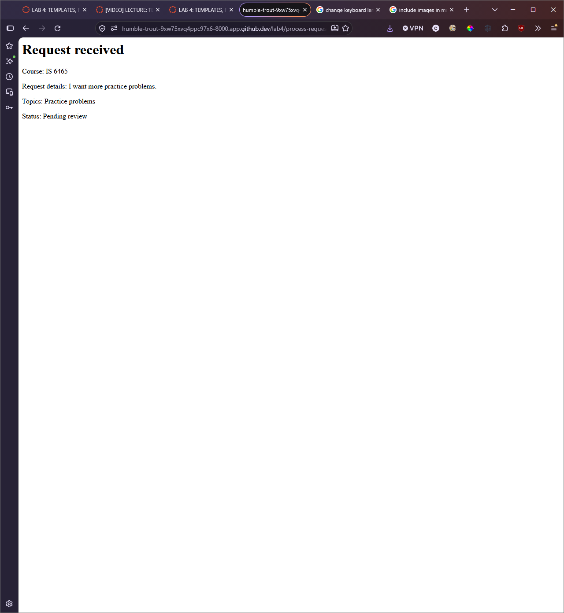

# Lab 4

## Part 1: Run the application

After submitting the form, I am redirected to a page called "process-request.php"
I see my request data displayed back to me.

## Part 2: Trace the templates

1. header.php provides the opening portion of every page. Things like doctype, css references, and the title.
2. nav.php provides the navigation bar to every page, it has links to see existing requests and submit a new one.
3. footer.php closes the tags that are opened in the header.php file. This also includes a bootstrap js file.
4. require-once is appropriate for these files because we don't want them to be included multiple times. The opening tags defined in the header shouldn't be opened more than once, etc.
5. The shared CSS file is linked in header.php

## Part 3: Observe the form controls
1. reason: This control is a text entry and allows students to identify what the purpose of their visit is. PHP receives this as a string.
2. topics[]: This control is made of check-boxes. It allows students to select which courses they need help with. PHP receives this as an array.
3. preferredtime: This control is a set of radio buttons. It allows students to select what their preferred time is. PHP receives this as a single string.
4. preferreddate: This control is a date picker. It allows students to choose what day they would like to receive a tutoring session. PHP receives this value as a date.
5. form_name: This control is a hidden control with a value to specify what this specific form is. PHP receives this value a string.

## Part 4: Test validation behavior

### Valid request
1. Values:
    - Topics: "Exam review"
    - Preferred time: "Morning"
    - Course: "IS 6465"
    - Preferred date: "10/31/2026"
    - What would...help with: "I need to review for the exam"
2. Status: Accepted
3. Message: "Request received" along with some submission details.
4. A student can submit a new request for tutoring.

### Missing or invalid value
1. Values:
    - Topics: ""
    - Preferred time: "Morning"
    - Course: "IS 6465"
    - Preferred date: "10/31/2026"
    - What would...help with: "I need to review for the exam"
2. Status: Rejected
3. Message: "Request could not be submitted", "Select at least one valid topic."
4. Every request must have the course/s the student needs help with.

### Past date
1. Values:
    - Topics: "Exam review"
    - Preferred time: "Morning"
    - Course: "IS 6465"
    - Preferred date: "10/29/2026"
    - What would...help with: "I need to review for the exam"
2. Status: Rejected
3. Message: "Request could not be submitted", "Preferred date cannot be in the past".
4. Every request must have a date in the future relative to when the request is submitted.

## Part 5: Review testing and CRUD pages:

### TEST:
- Valid time: PASS
- Missing time: PASS
- Altered value: PASS
- Multiple valid topics: PASS
- Missing topics: PASS
- Altered topic: PASS
- Minimum length: PASS
- Maximum length: PASS
- Too short: PASS
- Too long: PASS

### CRUD

| CRUD action | Page |
| --- | --- |
| Create | process-request.php |
| Read one request | request-details.php |
| Read all requests | requests.php |
| Update | edit-request.php |
| Delete | delete-resuest.php |

### Questions
1. request_id=12
2. GET is to read the data, we don't want to change anything when just viewing a request.
3. POST is intended to change the data. When we are updating or editing a request, we intend to change the data.
